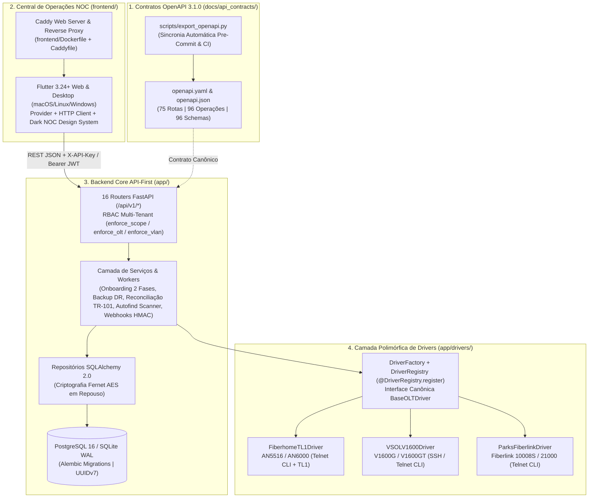

# SDD — System Design & Specification Document (`oltapi`)

**Versão:** 1.0 (Realinhamento Arquitetural & Spec-Driven Development)  
**Data de Atualização:** 14 de Outubro de 2026  
**Status:** Especificação Oficial Ativa (Fonte Única da Verdade de Engenharia)

---

## 1. Propósito e Escopo do SDD

Este **System Design & Specification Document (SDD)** consolida a arquitetura real, os contratos de comunicação, a governança de drivers, o modelo de dados relacional, os controles de segurança, o estado de implementação de cada componente e o plano estruturado de evolução do **OLTAPI**.

Qualquer nova funcionalidade, refatoração, homologação de equipamento ou correção deve respeitar estritamente os 5 pilares abaixo:

1. **Workflow API-First & Sincronia Obrigatória ([`docs/api_contracts/`](file:///Volumes/240/Code/oltapi/docs/api_contracts)):** O backend é 100% REST JSON (sem servir páginas estáticas em `app/static/`). Antes de qualquer commit/push, `python -m scripts.export_openapi` sincroniza `openapi.yaml` e `openapi.json` (**75 rotas**, **96 operações HTTP** e **96 schemas**).
2. **Governança de Drivers & Proibição de Fabricantes Teóricos ([`AGENTS.md`](file:///Volumes/240/Code/oltapi/AGENTS.md)):** É terminantemente proibido adicionar drivers de fabricantes sem acesso a hardware físico de bancada para homologação com tráfego real. Todo driver herda de [`BaseOLTDriver`](file:///Volumes/240/Code/oltapi/app/drivers/base.py), auto-registra-se via `@DriverRegistry.register` em [`app/drivers/registry.py`](file:///Volumes/240/Code/oltapi/app/drivers/registry.py) e passa na suíte [`BaseDriverComplianceTest`](file:///Volumes/240/Code/oltapi/tests/unit/test_driver_compliance.py).
3. **Isolamento Radical (Ports & Adapters):** Um driver nunca importa outro driver. É proibido usar `hasattr(driver, ...)` ou condicionais de fabricante (`if olt.vendor == ...`) nos serviços de negócio.
4. **Zero Dados Falsos e Desenvolvimento Estritamente Sob Demanda:** Proibição total de dados mocados, cards inventados ou funcionalidades não solicitadas. Em telas Flutter, aplicação obrigatória de constraints defensivas (`Expanded`, `Flexible`, `SingleChildScrollView`, `TextOverflow.ellipsis`) com tolerância zero a pixel overflow.
5. **Segurança em Primeiro Lugar & Testes Obrigatórios:** Identificadores **UUIDv7** (RFC 9562), sanitização estrita contra CLI Command Injection, autenticação JWT Bearer + API Keys com hash SHA-256, validação de subconjunto de escopos RBAC, isolamento Multi-Tenant por OLT/VLAN, criptografia Fernet AES em repouso (OLT, FTP e Webhooks), proteção SSRF e **100% de aprovação na suíte de testes (`pytest` e `flutter test`)**.

---

## 2. Topologia do Repositório

O projeto é organizado em **4 camadas desacopladas** mais a camada de infraestrutura containerizada:

### 2.1. Resumo Tecnológico e Licenciamento por Diretório

| Componente | Diretório | Stack Tecnológica Real | Licença | Papel no Ecossistema |
| :--- | :--- | :--- | :--- | :--- |
| **Contratos API** | [`docs/api_contracts/`](file:///Volumes/240/Code/oltapi/docs/api_contracts) | OpenAPI 3.1.0 (`openapi.yaml` e `openapi.json`) | GNU AGPLv3 | Fonte única da verdade para rotas REST, schemas Pydantic v2, HATEOAS e escopos RBAC |
| **Backend Core** | [`app/`](file:///Volumes/240/Code/oltapi/app) | Python 3.11–3.13, FastAPI, Pydantic v2, SQLAlchemy 2.0, Cryptography (Fernet), Scrapli/Paramiko/Telnet RFC 854 | GNU AGPLv3 | Orquestração de provisionamento, telemetria óptica, backups DR, reconciliação TR-101, RBAC e webhooks |
| **Drivers Homologados** | [`app/drivers/`](file:///Volumes/240/Code/oltapi/app/drivers) | Polimorfismo OO (`BaseOLTDriver` + `DriverRegistry`) | GNU AGPLv3 | Comunicação direta com OLTs físicas homologadas em bancada (`fiberhome`, `vsol`, `parks`) |
| **Migrações DB** | [`alembic/`](file:///Volumes/240/Code/oltapi/alembic) | Alembic + PostgreSQL 16 / SQLite WAL | GNU AGPLv3 | Versionamento evolutivo e idempotente do schema relacional |
| **Frontend NOC** | [`frontend/`](file:///Volumes/240/Code/oltapi/frontend) | Flutter 3.24+ (Dart 3.5+), Provider, HTTP, Google Fonts, Caddy 2 Alpine | GNU AGPLv3 | Central de Operações NOC para Desktop e Web com telemetria óptica real e ações de ciclo de vida |
| **Suíte de Qualidade** | [`tests/unit/`](file:///Volumes/240/Code/oltapi/tests/unit) | Pytest, Testcontainers PostgreSQL 16, `BaseDriverComplianceTest` | GNU AGPLv3 | 253 testes automatizados validando segurança, drivers, RBAC, contratos e regras de negócio |

---

## 3. Governança de Contratos OpenAPI 3.1.0 & Domínios da API

### 3.1. Sincronia e Validação Contínua
- **Arquivos Canônicos:** [`docs/api_contracts/openapi.yaml`](file:///Volumes/240/Code/oltapi/docs/api_contracts/openapi.yaml) e [`docs/api_contracts/openapi.json`](file:///Volumes/240/Code/oltapi/docs/api_contracts/openapi.json).
- **Geração Determinística:** Executada via [`scripts/export_openapi.py`](file:///Volumes/240/Code/oltapi/scripts/export_openapi.py) e validada automaticamente por [`tests/unit/test_openapi_sync.py`](file:///Volumes/240/Code/oltapi/tests/unit/test_openapi_sync.py) e pelos workflows [`.github/workflows/ci.yml`](file:///Volumes/240/Code/oltapi/.github/workflows/ci.yml) e [`.github/workflows/release.yml`](file:///Volumes/240/Code/oltapi/.github/workflows/release.yml).

### 3.2. Mapa dos 16 Routers REST (`app/api/v1/`)

| Domínio / Router | Arquivo | Escopo RBAC Principal | Responsabilidade |
| :--- | :--- | :--- | :--- |
| **Setup Inicial** | [`endpoints_setup.py`](file:///Volumes/240/Code/oltapi/app/api/v1/endpoints_setup.py) | Público (se virgem) / `X-API-Key` | Verificação de estado inicial (`/setup/status`) e bootstrap do tenant dono e super admin (`/setup/init`) |
| **Autenticação** | [`endpoints_auth.py`](file:///Volumes/240/Code/oltapi/app/api/v1/endpoints_auth.py) | Público (`/login`) / Autenticado (`/me`) | Emissão de token JWT Bearer stateless e inspeção do contexto autenticado |
| **Tenants (Rede Neutra)** | [`endpoints_tenants.py`](file:///Volumes/240/Code/oltapi/app/api/v1/endpoints_tenants.py) | `tenants:manage` | Gestão de operadoras (`PROVIDER_OWNER` e `WHOLESALE_TENANT`), alocação de OLTs e VLANs permitidas |
| **Usuários RBAC** | [`endpoints_users.py`](file:///Volumes/240/Code/oltapi/app/api/v1/endpoints_users.py) | `users:manage` | CRUD de operadores vinculados a tenants com papéis (`SUPER_ADMIN`, `NOC_ADMIN`, `NOC_OPERATOR`, `READ_ONLY`) |
| **Chaves de API** | [`endpoints_api_keys.py`](file:///Volumes/240/Code/oltapi/app/api/v1/endpoints_api_keys.py) | `api_keys:manage` | Emissão e revogação de chaves para ERPs com hash SHA-256 e validação estrita de subconjunto de escopos |
| **Concentradores OLT** | [`endpoints_olts.py`](file:///Volumes/240/Code/oltapi/app/api/v1/endpoints_olts.py) | `olts:read` / `olts:admin` / `backups:*` | CRUD de OLTs, Onboarding Zero-Touch (`onboard`, `inspect`, `onboard-wizard` + SSE), Raio-X SNMP (`xray`), `running-config`, `sync` e backups por OLT |
| **VLANs & Profiles** | [`endpoints_vlans.py`](file:///Volumes/240/Code/oltapi/app/api/v1/endpoints_vlans.py) | `olts:read` / `olts:admin` | Listagem e criação de VLANs na flash, métricas de ocupação, histórico por VLAN, perfis e `provisioning-schema` dinâmico |
| **Políticas PON & Cutover**| [`endpoints_pon_policies.py`](file:///Volumes/240/Code/oltapi/app/api/v1/endpoints_pon_policies.py) | `olts:read` / `onus:provision` | Defaults de VLAN/Profile por porta PON (Smart Pre-fill) e janelas temporizadas de Cutover Zero-Touch |
| **Diagnóstico Óptico** | [`endpoints_diagnostics.py`](file:///Volumes/240/Code/oltapi/app/api/v1/endpoints_diagnostics.py) | `onus:read` | Listagem de ONUs por porta PON e leitura em tempo real de potência óptica (`rx_power_dbm`, `tx_power_dbm`, `olt_rx_power_dbm`) |
| **Provisionamento & Ciclo**| [`endpoints_provision.py`](file:///Volumes/240/Code/oltapi/app/api/v1/endpoints_provision.py) | `onus:discover` / `onus:provision` / `onus:operate` / `onus:delete` | Autofind (`unauthorized`), ativação de ONU, `reboot`, `suspend` (bloqueio), `resume` (desbloqueio) e `DELETE` |
| **Inventário TR-101** | [`endpoints_onu_inventory.py`](file:///Volumes/240/Code/oltapi/app/api/v1/endpoints_onu_inventory.py) | `onus:read` / `onus:provision` | Inventário perpétuo de ONUs, Circuit ID Broadband Forum TR-101, auto-reconciliação de campo e linha do tempo global do NOC |
| **Backups Globais** | [`endpoints_backups.py`](file:///Volumes/240/Code/oltapi/app/api/v1/endpoints_backups.py) | `backups:create` / `backups:read` | Disparo em lote (`run-all`), auditoria global de integridade SHA-256 (`audit-all`) e expurgo (`purge-all`) |
| **Servidores FTP** | [`endpoints_ftp.py`](file:///Volumes/240/Code/oltapi/app/api/v1/endpoints_ftp.py) | `backups:read` / `olts:admin` | Cadastro de servidores FTP com senha cifrada Fernet, teste de upload/deleção real e vínculo por OLT |
| **Bootstrap Inicial** | [`endpoints_bootstrap.py`](file:///Volumes/240/Code/oltapi/app/api/v1/endpoints_bootstrap.py) | `olts:admin` | Preview e aplicação de scripts de inicialização para OLTs recém-instaladas |
| **Autofind Scanner** | [`endpoints_scanner.py`](file:///Volumes/240/Code/oltapi/app/api/v1/endpoints_scanner.py) | `onus:discover` / `olts:admin` | Status, `start`, `stop`, `run-now` e ajuste de intervalo do worker periódico em background |
| **Webhooks HMAC** | [`endpoints_webhooks.py`](file:///Volumes/240/Code/oltapi/app/api/v1/endpoints_webhooks.py) | `webhooks:manage` | Assinaturas de eventos para ERPs com segredo cifrado Fernet, assinatura HMAC-SHA256, ping e log de entregas |

---

## 4. Arquitetura do Backend (`app/`) & Governança de Drivers

### 4.1. Matriz de Concentradores Homologados em Hardware Físico

> [!IMPORTANT]
> **Proibição de Fabricantes Teóricos:** Apenas equipamentos validados em bancada física real com leitura óptica, persistência na memória não-volátil e provisionamento com tráfego real integram a árvore do projeto.

| Fabricante (`vendor`) | Prefixos (`model_prefix`) | Classe do Driver | Protocolos | Quirks de Hardware Tratados & Evidências |
| :--- | :--- | :--- | :---: | :--- |
| **`fiberhome`** | `an5516`, `an6000` | [`FiberhomeTL1Driver`](file:///Volumes/240/Code/oltapi/app/drivers/fiberhome/fiberhome_tl1.py) | Telnet CLI (23) / TL1 (3337) | Paginação suprimida, navegação `cd service` para descoberta SNMP, leitura óptica dupla (ONU RX + OLT RX), modos Router PPPoE, Bridge e VEIP, upload FTP nativo com fallback terminal. |
| **`vsol`** | `v1600` (`v1600g`, `v1600gt`) | [`VSOLV1600Driver`](file:///Volumes/240/Code/oltapi/app/drivers/vsol/vsol_v1600.py) | SSH (22) / Telnet (23) | Senha em `enable`, submodo obrigatório `commit` em perfis (`dba`, `line`, `srv`), `p2p enable` intra-PON, desbloqueio ACL SNMP (`login-access-list`), inspeção AUX vs SVI In-Band e gravação via `write`. Relatório: [`HOMOLOGACAO_VSOL_V1600.md`](file:///Volumes/240/Code/oltapi/docs/HOMOLOGACAO_VSOL_V1600.md). |
| **`parks`** | `fiberlink`, `10008`, `21000`, `2000` | [`ParksFiberlinkDriver`](file:///Volumes/240/Code/oltapi/app/drivers/parks/parks_fiberlink.py) | Telnet (23) | Contorno de segfault do Dropbear SSH via Telnet RFC 854 com handshake `<RETURN>`, `terminal length 0`, ativação de LANs via `ethernet-profile auto-on uni-port 1-4`, bloqueio por `gpon blacklist`, leitura dupla (`status` + `rssi`) e gravação via `copy running-config startup-config`. Relatório: [`HOMOLOGACAO_PARKS_FIBERLINK.md`](file:///Volumes/240/Code/oltapi/docs/HOMOLOGACAO_PARKS_FIBERLINK.md). |

### 4.2. Suíte de Conformidade Obrigatória (`BaseDriverComplianceTest`)
Todo driver registrado no [`DriverRegistry`](file:///Volumes/240/Code/oltapi/app/drivers/registry.py) é submetido automaticamente aos testes polimórficos em [`tests/unit/test_driver_compliance.py`](file:///Volumes/240/Code/oltapi/tests/unit/test_driver_compliance.py), cobrindo:
1. `get_running_config`
2. `backup_config` (prioridade FTP nativo + fallback terminal)
3. `get_chassis_interfaces` (sem dados inventados)
4. `get_onu_details` (potências ópticas reais em dBm)
5. `provision_onu`
6. `deprovision_onu`
7. `suspend_onu`
8. `resume_onu`
9. `reboot_onu`
10. `configure_snmp`
11. `list_all_authorized_onus`
12. `inspect_management_arch` e `execute_wizard_commissioning`

### 4.3. Histórico Completo de Migrações Alembic (`alembic/versions/`)

| Revisão | Arquivo | Descrição Técnica |
| :--- | :--- | :--- |
| `cf1f56210add` | [`cf1f56210add_initial_schema.py`](file:///Volumes/240/Code/oltapi/alembic/versions/cf1f56210add_initial_schema.py) | Schema inicial com chaves primárias UUIDv7: `olts`, `backups`, `onu_inventory`, `onu_events`, `webhooks` e `webhook_deliveries`. |
| `f26d8bd34ea0` | [`f26d8bd34ea0_add_ftp_servers_tables.py`](file:///Volumes/240/Code/oltapi/alembic/versions/f26d8bd34ea0_add_ftp_servers_tables.py) | Criação da tabela `ftp_servers` e coluna `ftp_server_id` em `olts` para destinos de backup multi-FTP. |
| `a38c91d4e5f0` | [`a38c91d4e5f0_add_rbac_and_multitenant_tables.py`](file:///Volumes/240/Code/oltapi/alembic/versions/a38c91d4e5f0_add_rbac_and_multitenant_tables.py) | Criação das tabelas `tenants`, `users` e `api_keys` para controle de acesso RBAC e isolamento Multi-Tenant (Rede Neutra). |
| `b51f89c10f3a` | [`b51f89c10f3a_add_onu_vlan_history.py`](file:///Volumes/240/Code/oltapi/alembic/versions/b51f89c10f3a_add_onu_vlan_history.py) | Criação da tabela `onu_vlan_history` para rastreabilidade histórica de movimentações de assinantes por VLAN. |
| `c72e91d5f0b1` | [`c72e91d5f0b1_add_snmp_and_partitioned_telemetry.py`](file:///Volumes/240/Code/oltapi/alembic/versions/c72e91d5f0b1_add_snmp_and_partitioned_telemetry.py) | Adição de colunas SNMP em `olts` e criação de `olt_chassis_telemetry`, `olt_pon_port_telemetry` e `olt_vlan_catalog`. |
| `d83f92e6a1b2` | [`d83f92e6a1b2_add_pon_policies_and_tasks.py`](file:///Volumes/240/Code/oltapi/alembic/versions/d83f92e6a1b2_add_pon_policies_and_tasks.py) | Criação das tabelas `pon_policies` (Smart Pre-fill por porta PON) e `auto_provision_tasks` (janelas temporizadas de Cutover Zero-Touch). |

### 4.4. Segurança, Criptografia e RBAC Multi-Tenant
Detalhes aprofundados constam em [`docs/SECURITY_BASELINE.md`](file:///Volumes/240/Code/oltapi/docs/SECURITY_BASELINE.md):
- **Autenticação Dual (`get_auth_context` em [`app/api/deps.py`](file:///Volumes/240/Code/oltapi/app/api/deps.py)):** Suporta cabeçalho `X-API-Key` (comparação time-safe `hmac.compare_digest` para chave master ou busca por hash SHA-256 em `api_keys`) e `Authorization: Bearer <jwt>` (HMAC-SHA256).
- **Enforçamento Granular (`AuthContext`):**
  - `ctx.enforce_scope(scope)`: Verifica permissão específica da rota (`olts:read`, `olts:admin`, `onus:provision`, `backups:create`, `api_keys:manage`, etc.).
  - `ctx.enforce_olt(olt_id)` e `ctx.enforce_vlan(vlan_id)`: Garante isolamento multi-tenant para operadoras locatárias (`WHOLESALE_TENANT`) em cenários de Rede Neutra.
  - **Prevenção de Elevação de Privilégio:** Operadores sem escopo curinga `*` só podem gerar chaves de API cujos escopos sejam estritamente um subconjunto de seus próprios escopos.
- **Criptografia em Repouso (Fernet AES):** Senhas de OLTs (`olts.password`), senhas de servidores FTP (`ftp_servers.password`), comunidades SNMP (`olts.snmp_ro_community`) e segredos HMAC de Webhooks (`webhooks.secret`) são cifrados em repouso via [`encrypt_password` / `decrypt_password`](file:///Volumes/240/Code/oltapi/app/core/security.py).
- **Blindagem contra CLI Command Injection e SSRF:** Sanitizadores regex estritos (`sanitize_port`, `sanitize_serial`, `sanitize_vlan`, `sanitize_safe_string`, `sanitize_webhook_url`) bloqueiam metacaracteres de terminal e chamadas Webhook para loopback (`127.0.0.0/8`, `localhost`), link-local/metadata (`169.254.0.0/16`) ou esquemas inválidos.

---

## 5. Matriz de Implementação do `frontend/` (Flutter NOC) e Plano de Evolução

### 5.1. Fase 1 (Concluída) — Core Operacional do Frontend NOC (`frontend/lib/`)

| Módulo / Tela | Arquivos Principais | Endpoints Consumidos | Status |
| :--- | :--- | :--- | :---: |
| **Setup & Autenticação** | [`login_screen.dart`](file:///Volumes/240/Code/oltapi/frontend/lib/screens/auth/login_screen.dart), [`setup_screen.dart`](file:///Volumes/240/Code/oltapi/frontend/lib/screens/auth/setup_screen.dart), [`auth_provider.dart`](file:///Volumes/240/Code/oltapi/frontend/lib/providers/auth_provider.dart) | `GET /setup/status`, `POST /setup/init`, `POST /auth/login`, `GET /auth/me` | **Concluído** |
| **Shell NOC & Healthcheck** | [`app_shell.dart`](file:///Volumes/240/Code/oltapi/frontend/lib/screens/shell/app_shell.dart), [`settings_screen.dart`](file:///Volumes/240/Code/oltapi/frontend/lib/screens/settings/settings_screen.dart) | `GET /health`, `GET /api/v1/olts` | **Concluído** |
| **Aguardando Autorização (Autofind & Provisionamento Dinâmico)** | [`unconfigured_screen.dart`](file:///Volumes/240/Code/oltapi/frontend/lib/screens/unconfigured/unconfigured_screen.dart), [`authorize_onu_dialog.dart`](file:///Volumes/240/Code/oltapi/frontend/lib/screens/unconfigured/authorize_onu_dialog.dart) | `GET /olts/{id}/unauthorized`, `GET /olts/{id}/provisioning-schema`, `GET /olts/{id}/pon-policies`, `GET /olts/{id}/auto-provision-tasks`, `POST /olts/{id}/onus` | **Concluído** |
| **ONUs Autorizadas & Diagnóstico Óptico Real** | [`configured_screen.dart`](file:///Volumes/240/Code/oltapi/frontend/lib/screens/configured/configured_screen.dart), [`onu_detail_dialog.dart`](file:///Volumes/240/Code/oltapi/frontend/lib/screens/configured/onu_detail_dialog.dart) | `GET /olts/{id}/ports/{port}/onus`, `GET /olts/{id}/onus/{serial}`, `POST .../reboot`, `POST .../suspend`, `POST .../resume`, `DELETE .../onus/{serial}` | **Concluído** |
| **Concentradores OLT, Running-Config, Backups & Políticas PON** | [`olts_screen.dart`](file:///Volumes/240/Code/oltapi/frontend/lib/screens/olts/olts_screen.dart), [`olt_form_dialog.dart`](file:///Volumes/240/Code/oltapi/frontend/lib/screens/olts/olt_form_dialog.dart), [`olt_backups_dialog.dart`](file:///Volumes/240/Code/oltapi/frontend/lib/screens/olts/olt_backups_dialog.dart), [`pon_policies_dialog.dart`](file:///Volumes/240/Code/oltapi/frontend/lib/screens/olts/pon_policies_dialog.dart), [`backups_screen.dart`](file:///Volumes/240/Code/oltapi/frontend/lib/screens/backups/backups_screen.dart) | `GET/POST/PUT/DELETE /olts`, `POST /olts/{id}/test-connection`, `GET /olts/{id}/config`, `GET/POST /olts/{id}/backups`, `PUT/DELETE /olts/{id}/pon-policies`, `POST/DELETE /olts/{id}/auto-provision-tasks` | **Concluído** |

### 5.2. Ondas Subsequentes no `frontend/` (Estritamente Sob Demanda)

Os módulos abaixo já possuem **100% dos endpoints e testes prontos no Backend (`app/api/v1/`)** e estão organizados em ondas sequenciais para implementação sob demanda no Flutter NOC:

- **Onda A — Onboarding Zero-Touch Wizard (2 Fases), Raio-X de Chassi & Gestão de VLANs:**
  - **Wizard de Onboarding Assistido:** Integração das rotas `POST /api/v1/olts/inspect` (Fase 1: Pré-inspeção não-destrutiva AUX vs In-Band), `POST /api/v1/olts/onboard-wizard` (Fase 2: Comissionamento assistido) e `POST /api/v1/olts/onboard/stream` (progresso em tempo real via SSE).
  - **Painel de Raio-X & Telemetria SNMP:** Visualização de chassi, portas físicas e ocupação PON (`GET /api/v1/olts/{id}/xray` e `POST /api/v1/olts/{id}/sync`).
  - **Catálogo e Métricas de VLANs:** Listagem, criação na flash, enriquecimento e histórico de clientes por VLAN (`GET/POST /api/v1/olts/{id}/vlans`, `GET /api/v1/olts/{id}/vlans/metrics`, `GET /api/v1/olts/{id}/vlans/{vlan_id}/history`, `POST /api/v1/olts/{id}/vlans/enrich`).

- **Onda B — Disaster Recovery Avançado (Multi-FTP, Unified Diff Visual, Auditoria SHA-256 & Expurgo):**
  - **Gestão de Servidores FTP Remotos:** CRUD de destinos FTP, teste de conectividade/escrita real e vínculo por OLT (`GET/POST/PUT/DELETE /api/v1/ftp-servers`, `POST /api/v1/ftp-servers/{id}/test`, `PUT /api/v1/olts/{id}/ftp-destination`).
  - **Comparador de Configurações (Unified Diff) & Auditoria de Integridade:** Visualizador lado a lado / linha a linha de alterações entre snapshots (`GET /api/v1/olts/{id}/backups/compare`), auditoria de integridade SHA-256 (`GET /api/v1/olts/{id}/backups/audit`, `GET /api/v1/backups/audit-all`) e políticas de expurgo com `dry_run` (`POST /api/v1/olts/{id}/backups/purge`, `POST /api/v1/backups/purge-all`).

- **Onda C — Supervisão Autônoma, Conciliação TR-101, Webhooks HMAC & Governança RBAC Multi-Tenant (Rede Neutra):**
  - **Painel do Autofind Scanner & Timeline TR-101:** Controle operacional do worker em background (`GET /api/v1/scanner/status`, `POST /scanner/start`, `POST /scanner/stop`, `POST /scanner/run-now`, `PATCH /scanner/interval`), linha do tempo global de eventos do NOC (`GET /api/v1/onus/history`) e conciliação reativa (`POST /api/v1/onus/reconcile-field-event`).
  - **Assinaturas de Webhooks HMAC:** Gestão de endpoints de notificação para ERPs, disparo de ping de teste e auditoria de entregas (`GET/POST/DELETE /api/v1/webhooks`, `POST /api/v1/webhooks/{id}/ping`, `GET /api/v1/webhooks/deliveries`).
  - **Governança RBAC & Rede Neutra:** Administração de Tenants/Operadoras (`GET/POST/PATCH /api/v1/tenants`), Usuários (`GET/POST/DELETE /api/v1/users`) e Chaves de API com escopos granulares (`GET/POST/DELETE /api/v1/api-keys`).
