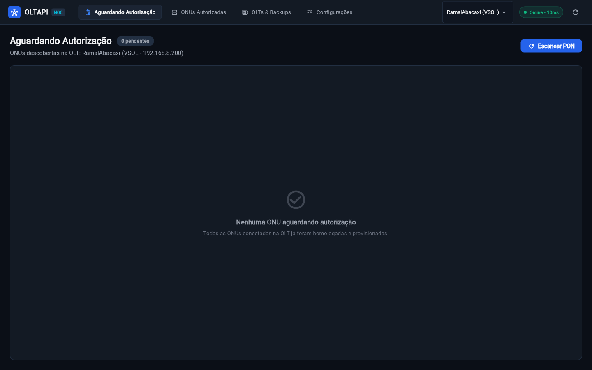
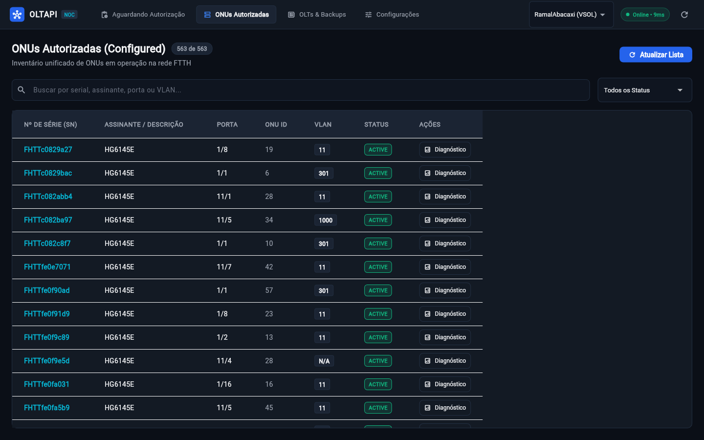
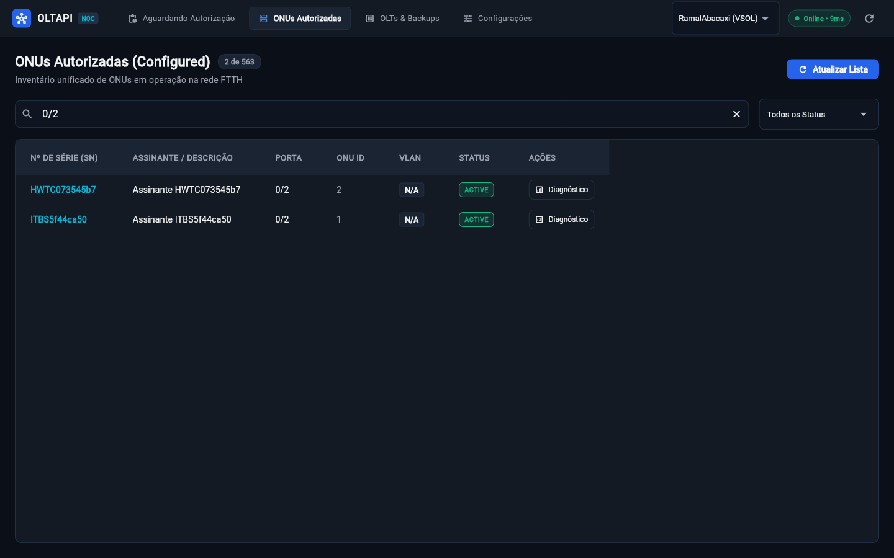
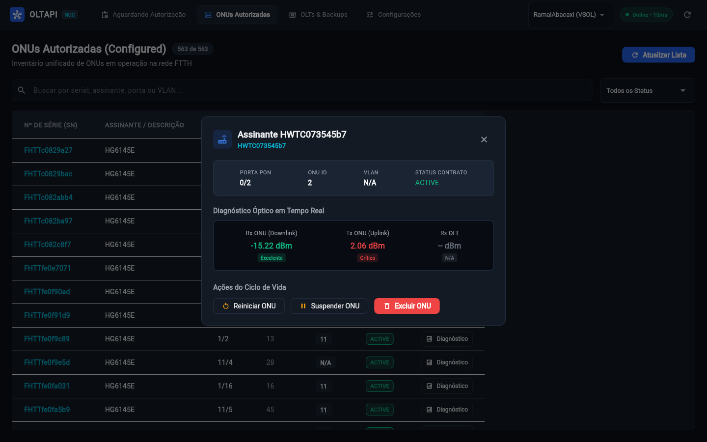
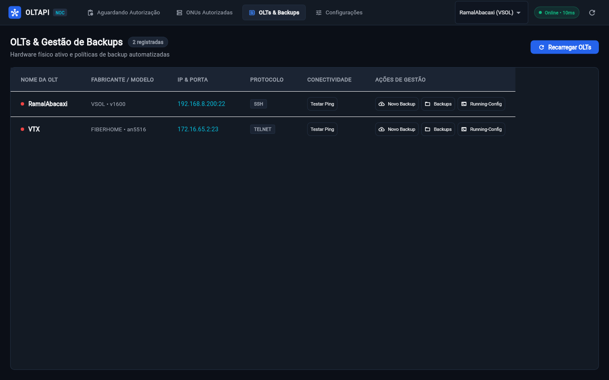
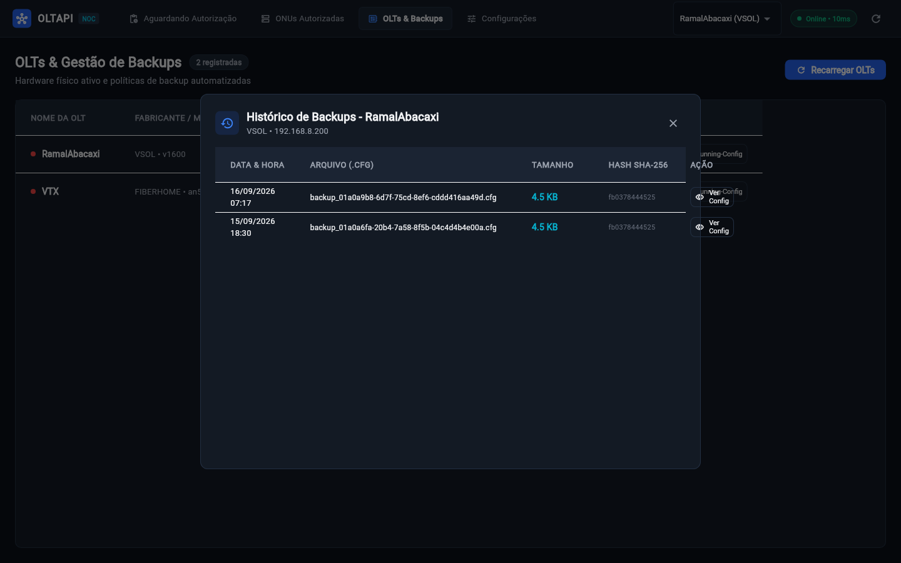
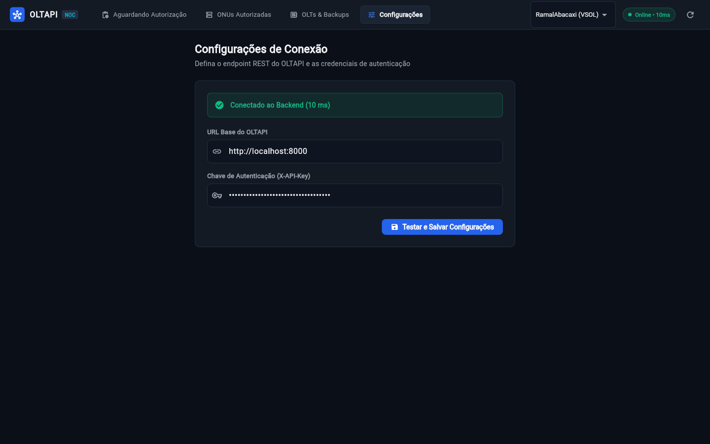

# 🖥️ Frontend NOC (Central de Operações em Flutter)

O **Frontend NOC do OLTAPI** é uma aplicação multi-plataforma moderna desenvolvida em **Flutter** (Web e Desktop macOS/Linux/Windows), projetada especificamente para provedores de internet (ISPs), operadores de Rede Neutra e centros de operações de rede (NOC). A aplicação entrega **100% de paridade operacional** com os contratos REST do backend ([`docs/SDD.md`](SDD.md)), cobrindo desde o provisionamento GPON em 1-clique até Onboarding Zero-Touch, Disaster Recovery Multi-FTP com Unified Diff e Governança RBAC Multi-Tenant.

---

## 🎯 Princípios de Design & Arquitetura

1. **Desacoplamento Radical (API-First):** O frontend opera de forma 100% independente do backend FastAPI. O backend expõe exclusivamente endpoints REST JSON, enquanto o frontend reside no diretório `frontend/` e se comunica via HTTP com autenticação JWT Bearer e `X-API-Key`.
2. **Design System NOC Dark Mode:** Paleta de cores em modo escuro de alto contraste (`#0B0F17`, `#131A24`, `#222F42`, `#2563EB`) projetada para ambientes de monitoramento 24/7 sem fadiga visual.
3. **Semântica Óptica Instantânea:** Indicadores visuais claros para qualidade do sinal óptico recebido (Rx Power em dBm):
   - 🟢 **Excelente:** Sinal entre `-8.0 dBm` e `-25.0 dBm`.
   - 🟡 **Atenção:** Sinal entre `-25.0 dBm` e `-28.0 dBm` (limítrofe).
   - 🔴 **Crítico / Atenuado:** Sinal menor que `-28.0 dBm` ou maior que `-8.0 dBm` (saturado).
4. **Tolerância Zero a Overflows:** Componentes construídos com proteções defensivas (`Wrap`, `SingleChildScrollView`, `Flexible`, `Expanded`, `TextOverflow.ellipsis`, `isExpanded: true`) garantindo usabilidade impecável em qualquer resolução de tela.
5. **Zero Dados Falsos:** Interfaces 100% conectadas aos dados reais do hardware e do banco de dados, sem métricas fictícias ou mocks visuais. Quando não há dados, exibe estados vazios (*empty states*) limpos e objetivos.

---

## 🧭 Arquitetura de Navegação (6 Abas NOC)

```mermaid
flowchart TD
    Shell["AppShell - Topbar NOC (6 Abas)"] --> Tab1["1. Aguardando Autorização (Unconfigured)"]
    Shell --> Tab2["2. ONUs Autorizadas (Configured)"]
    Shell --> Tab3["3. Gerenciar OLTs (Inventário & Onda A)"]
    Shell --> Tab4["4. Gestão de Backups (Disaster Recovery & Onda B)"]
    Shell --> Tab5["5. Governança & Automação (Onda C)"]
    Shell --> Tab6["6. Configurações de Conexão"]

    Tab1 --> ModalAuth["Autorização 1-Clique + Políticas PON & Cutover"]
    Tab2 --> ModalDiag["Diagnóstico Óptico Real (Rx/Tx/OLT Rx) + Ciclo de Vida"]

    Tab3 --> ModalWizard["Onda A: Wizard Zero-Touch (Inspeção Fase 1 + Comissionamento Fase 2)"]
    Tab3 --> ModalXRay["Onda A: Raio-X de Chassi, Telemetria SNMP & Sync Brownfield"]
    Tab3 --> ModalVlans["Onda A: Catálogo Flash de VLANs, Métricas & Histórico"]
    Tab3 --> ModalPonPol["Políticas PON & Janelas de Cutover"]

    Tab4 --> SubTabAudit["Onda B: Snapshots, Detecção de Drift SHA-256 & Run-All"]
    Tab4 --> SubTabFtp["Onda B: Servidores FTP Remotos (CRUD & Diagnóstico de Escrita)"]
    SubTabAudit --> ModalDiff["Onda B: Comparador Visual Unified Diff & Destinos FTP por OLT"]

    Tab5 --> GovScanner["Onda C: Autofind Scanner + Timeline Global TR-101 + Reconciliação"]
    Tab5 --> GovWebhooks["Onda C: Webhooks ERP (HMAC-SHA256, Ping & Auditoria de Entregas)"]
    Tab5 --> GovTenants["Onda C: Inquilinos & Rede Neutra (Alocação de VLANs Atacado)"]
    Tab5 --> GovRbac["Onda C: Usuários RBAC & Chaves de API Granulares"]
```



---

### 1. Barra Superior NOC (`AppShell`) & Aguardando Autorização (`UnconfiguredScreen`)
A tela inicial conecta-se diretamente ao concentrador óptico selecionado e monitora novas ONUs que aguardam autorização (Autofind GPON):
- **Identidade Visual:** Logo OLTAPI com chip semântico `NOC`, seletor rápido de OLT e indicador de latência do backend (`Online • 10ms`).
- **Smart Pre-fill & Modo Cutover:** Pré-preenchimento dinâmico de VLAN e perfil de linha conforme a política da porta PON e banner em tempo real de janelas de Cutover Zero-Touch ativas.



---

### 2. ONUs Autorizadas (`ConfiguredScreen`) — Inventário FTTH
Inventário unificado de clientes ativos e suspensos na rede FTTH:
- **Busca Instantânea:** Filtro em tempo real por Número de Série, Nome do Assinante, Porta PON ou VLAN.
- **Filtro de Status:** Seleção rápida entre *Todas*, *Ativas (Online)* e *Suspensas / Bloqueadas*.
- **Ação Diagnóstico:** Abre o painel completo de telemetria óptica real e ações de ciclo de vida.



#### Filtro por Porta Física da OLT V-SOL (Porta `0/2`)
Isolamento instantâneo das ONUs ativas na porta GPON `0/2` da OLT V-SOL física na bancada de testes:



---

### 3. Diagnóstico Óptico em Tempo Real & Ciclo de Vida (`OnuDetailDialog`)
Ao clicar em **Diagnóstico** em qualquer ONU, o frontend consulta em tempo real a potência óptica na OLT:

#### Telemetria Óptica da ONU Huawei (`HWTC073545b7`) & Intelbras (`ITBS5f44ca50`)
- **Leituras Físicas:** `Rx ONU (Downlink)`, `Tx ONU (Uplink)` e `Rx OLT` em dBm com classificação semântica automática.
- **Comandos de Ciclo de Vida:** Reiniciar ONU (Reboot OMCI), Suspender por Inadimplência, Reativar e Excluir com confirmação de serial.

| Diagnóstico Óptico ONU Huawei | Diagnóstico Óptico ONU Intelbras |
| :---: | :---: |
|  |  |

---

### 4. Gerenciar OLTs & Onda A: Wizard Zero-Touch, Raio-X SNMP e Catálogo de VLANs (`OltsScreen`)
Controle completo do parque de concentradores ópticos físicos (`FIBERHOME`, `VSOL`, `PARKS`):
- **Wizard Zero-Touch em 2 Fases (`OltOnboardWizardDialog`):**
  - **Fase 1 (Inspeção Não-Destrutiva):** Executa `POST /api/v1/olts/inspect` para detectar automaticamente fabricante/modelo, cenário de acesso (`aux_only`, `aux_with_inband` ou `inband`), SVIs existentes, VLANs na flash e total de ONUs.
  - **Fase 2 (Comissionamento Assistido ou Zero-Touch 1-Clique):** Permite configurar gerência In-Band, VLANs iniciais (com suporte a `p2p enable` / LAN-to-LAN), comunidade SNMP e disparar o onboarding com geração obrigatória do **Snapshot Baseline v0**.
- **Raio-X de Chassi & Telemetria SNMP (`OltXRayDialog`):**
  - Exibe CPU, memória, temperatura, versão de firmware, uptime, status do agente SNMP e tabela de ocupação das portas GPON e Uplink (`POST /api/v1/olts/{id}/telemetry`).
  - Inclui o botão **Sincronizar Parque (Brownfield Sync)** (`POST /api/v1/olts/{id}/sync`) para importar ONUs e VLANs pré-existentes no hardware.
- **Catálogo Flash de VLANs & Histórico (`OltVlansDialog`):**
  - Lista métricas de ocupação por VLAN (`ONUs Provisionadas` vs `ONUs Ativas`), portas Tagged/Untagged, criação de novas VLANs na NVRAM (`POST /api/v1/olts/{id}/vlans`), enriquecimento automático (`enrich-vlans`) e histórico de assinantes por VLAN.
- **Políticas PON & Cutover (`PonPoliciesDialog`):** Definição de VLAN/Profile padrão por porta PON e criação de tarefas temporizadas de auto-provisionamento.



---

### 5. Gestão de Backups & Onda B: Disaster Recovery Multi-FTP, Unified Diff e Auditoria SHA-256 (`BackupsScreen` & `OltBackupsDialog`)
Central dedicada à continuidade operacional, auditoria criptográfica de configurações e repositórios FTP remotos:
- **Ações Globais do Parque:**
  - **Backup em Lote (`Run All`):** Dispara coleta simultânea em todas as OLTs ativas com expurgo pós-coleta opcional (`POST /api/v1/backups/run-all`).
  - **Auditar Parque (`SHA-256`):** Inspeciona todos os snapshots em busca de **Configuration Drift** (`GET /api/v1/backups/audit-all`), sinalizando em cada card de OLT o badge `DRIFT DETECTADO` ou `ÍNTEGRO`.
  - **Política de Expurgo Global:** Remove snapshots excedentes por quantidade máxima ou idade em dias (`POST /api/v1/backups/purge-all`).
- **Comparador Visual Unified Diff (`OltBackupsDialog`):**
  - Compara quaisquer dois snapshots de uma OLT (`GET /api/v1/olts/{id}/backups/compare`) exibindo contagem de linhas adicionadas/removidas (`+N / -M`) e diff colorido linha a linha (`+` em verde, `-` em vermelho, `@@` em ciano).
- **Servidores FTP Remotos & Vínculos por OLT:**
  - Sub-aba dedicada para cadastrar, editar e excluir servidores FTP (`GET/POST/PUT/DELETE /api/v1/ftp-servers`), definir repositórios `GLOBAL DEFAULT` e vincular destinos FTP específicos por OLT (`POST /api/v1/olts/{id}/ftp-servers`).
  - Botão **Testar FTP** (`POST /api/v1/ftp-servers/{id}/test`) que valida autenticação, diretório de trabalho (`PWD`), banner do servidor e latência em milissegundos.



---

### 6. Governança & Automação — Onda C (`GovernanceScreen`)
Painel unificado de supervisão autônoma, integração ativa com ERPs e isolamento Multi-Tenant para Rede Neutra, dividido em **4 sub-abas**:

1. **Scanner Autônomo & Timeline TR-101:**
   - Controle em tempo real do worker de supervisão PON (`Iniciar`, `Parar`, `Ciclo Imediato / Run Now` e ajuste de intervalo em segundos via `/api/v1/scanner/*`).
   - Linha do tempo global de eventos e migrações físicas (`GET /api/v1/onus/history`) com filtro por serial, exibindo origem, destino e **Circuit ID Broadband Forum TR-101**.
   - Modal de **Reconciliação de Evento de Campo** (`POST /api/v1/onus/reconcile-field-event`) para manobras reativas de fusão/CEO.
2. **Webhooks ERP (HMAC-SHA256):**
   - Cadastro e exclusão de assinaturas de Webhooks (`GET/POST/DELETE /api/v1/webhooks`) com seleção de eventos (`*`, `onu.provisioned`, `onu.migrated`, `onu.deprovisioned`, `olt.backup_completed`).
   - Disparo de **Ping HMAC de Teste** (`POST /api/v1/webhooks/{id}/ping`) e tabela de auditoria de entregas HTTP (`GET /api/v1/webhooks/deliveries`) com status code e tempo de resposta em ms.
3. **Inquilinos & Rede Neutra (Wholesale Tenants):**
   - Administração de operadoras locatárias (`GET/POST /api/v1/tenants`) e alocação/revogação de VLANs exclusivas por OLT (`POST/DELETE /api/v1/tenants/{id}/vlans`), garantindo isolamento criptográfico e lógico entre provedores na mesma OLT física.
4. **Usuários RBAC & API Keys:**
   - Gestão completa de contas de usuário (`SUPER_ADMIN`, `NOC`, `WHOLESALE_TENANT`, `READ_ONLY`) com restrição opcional de OLTs permitidas (`allowed_olt_ids`).
   - Emissão e revogação de chaves de API (`GET/POST/DELETE /api/v1/api-keys`) com escopos granulares e exibição única da chave recém-gerada com cópia rápida.

---

### 7. Configurações & Conectividade (`SettingsScreen`)
- **Parâmetros da Conexão:** URL base da API (padrão: `http://localhost:8000`) e chave `X-API-Key`.
- **Healthcheck Automático:** Verificação de conectividade com medição de latência em tempo real (`Conectado ao Backend • 10 ms`).



---

## 🛠️ Como Executar o Frontend

### Pré-requisitos
- Flutter SDK 3.24+ (Dart 3.5+) instalado no ambiente (`flutter --version`).

### Executando em Modo Desktop (macOS / Linux / Windows) ou Web
```bash
cd frontend
flutter pub get

# Executar no macOS Desktop
flutter run -d macos

# Ou executar no navegador (Google Chrome)
flutter run -d chrome
```

---

## 🧪 Testes Automatizados & Qualidade de Código

O frontend conta com **21 testes automatizados** (unitários de modelos e testes de widgets cobrindo todas as telas e modais das Ondas A, B e C) e validação estática rigorosa:

```bash
cd frontend

# Análise estática de lints (0 issues)
flutter analyze

# Execução da suíte completa de testes (21/21 passando)
flutter test
```

**Cobertura da Suíte (`frontend/test/`):**
- [`models_test.dart`](file:///Volumes/240/Code/oltapi/frontend/test/models_test.dart): 16 grupos de testes cobrindo `OltModel`, `UnauthorizedOnu`, `ConfiguredOnu`, `OnuDiagnostics`, `BackupModel`, semântica óptica `AppColors`, `PonPolicyModel`, `AutoProvisionTaskModel`, `ProvisioningSchemaModel`, modelos da **Onda A** (`OltXRayModel`, `SyncOltResultModel`, `OltInspectResultModel`, `OltOnboardResultModel`, `VlanMetricsModel`, `VlanHistoryModel`), **Onda B** (`FtpServerModel`, `FtpTestResultModel`, `OltFtpDestinationsModel`, `BackupDiffResultModel`, `BackupAuditReportModel`, `PurgeResultModel`, `BatchBackupResultModel`) e **Onda C** (`ScannerStatusModel`, `ScannerRunResultModel`, `OnuMigrationEventModel`, `WebhookSubscriptionModel`, `WebhookDeliveryLogModel`, `TenantModel`, `UserAccountModel`, `ApiKeyCreatedModel`).
- [`widget_test.dart`](file:///Volumes/240/Code/oltapi/frontend/test/widget_test.dart): 5 suítes de testes de integração visual com `MockClient` HTTP validando a navegação completa da `AppShell`, os modais da **Onda A** (`Wizard Zero-Touch`, `Raio-X & Sync`, `VLANs`), a tela e modais da **Onda B** (`BackupsScreen`, `OltBackupsDialog`, `Unified Diff`, `Servidores FTP`) e as 4 sub-abas da **Onda C** (`GovernanceScreen`), com tolerância zero a pixel overflow.
