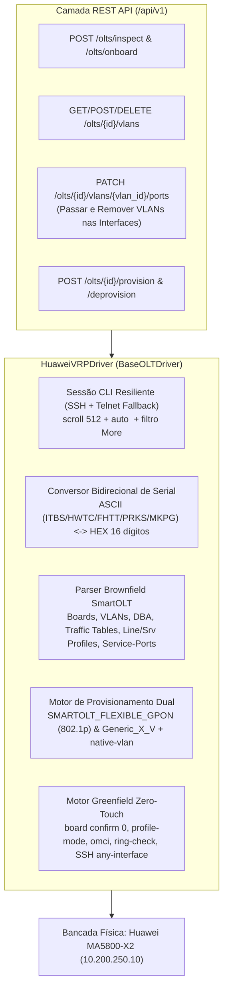

# Plano de Implementação e Homologação: Driver Huawei VRP (`SmartAX MA5800-X2`) — Migração SmartOLT & Comissionamento do Zero

Este plano estrutura a implementação do driver oficial **`HuaweiVRPDriver`** e a evolução dos contratos de gestão de VLANs/Interfaces no **OLTAPI**, cobrindo os **dois objetivos estratégicos** com validação real na bancada física (`10.200.250.10` — `Huawei SmartAX MA5800-X2`, firmware `MA5800V100R021C12 SPH305`):

1. **Objetivo 1 (Brownfield — Migração do SmartOLT para o OLTAPI):** Reconhecer integralmente a configuração deixada pelo SmartOLT (placas, portas, 98 ONTs multi-fabricante, 100 `service-ports`, `dba-profile`, `traffic table ip`, `ont-lineprofile` e `ont-srvprofile`), operar sobre essa base (provisionar/desprovisionar ONUs, criar/excluir VLANs e passar/remover VLANs nas interfaces de uplink) e assumir a gerência da caixa.
2. **Objetivo 2 (Greenfield — Configuração do Zero):** Ao final da validação do Objetivo 1, limpar as configurações de serviço na bancada e comissionar a OLT do zero usando o Wizard Zero-Touch do OLTAPI.

---

## Arquitetura da Solução

---

## Mudanças Propostas no Código

### 1. Contrato Base de Drivers e Gestão de VLANs nas Interfaces
Para suportar nativamente o requisito de **"passar e remover novas VLANs nas interfaces"** (além de criar e excluir VLANs):

#### [MODIFY] [vlan.py](file:///Volumes/240/Code/oltapi/app/models/vlan.py)
- Adicionar o schema `VLANPortBindingRequest`:
  - `add_ports: List[str] = Field(default_factory=list, description="Portas de uplink onde a VLAN deve ser passada (ex: ['0/4/3', '0/3/0'])")`
  - `remove_ports: List[str] = Field(default_factory=list, description="Portas de uplink de onde a VLAN deve ser removida")`

#### [MODIFY] [base.py](file:///Volumes/240/Code/oltapi/app/drivers/base.py)
- Adicionar os métodos polimórficos na interface `BaseOLTDriver` (com implementação padrão segura para retrocompatibilidade):
  - `delete_vlan(self, olt: OLTInDB, vlan_id: int) -> bool`: Remove os bindings de porta e exclui a VLAN da OLT.
  - `update_vlan_ports(self, olt: OLTInDB, vlan_id: int, add_ports: Optional[List[str]] = None, remove_ports: Optional[List[str]] = None) -> bool`: Passa (`port vlan`) ou remove (`undo port vlan`) uma VLAN nas interfaces de uplink especificadas.

#### [MODIFY] [endpoints_vlans.py](file:///Volumes/240/Code/oltapi/app/api/v1/endpoints_vlans.py)
- Adicionar endpoint `PATCH /api/v1/olts/{olt_id}/vlans/{vlan_id}/ports`: Permite passar e remover a VLAN nas interfaces de uplink da OLT e persiste na flash (`save_running_config`).
- Adicionar endpoint `DELETE /api/v1/olts/{olt_id}/vlans/{vlan_id}`: Remove uma VLAN da OLT (desfazendo antes os bindings de porta) e persiste na flash.

---

### 2. Implementação do Driver `HuaweiVRPDriver`

#### [NEW] [__init__.py](file:///Volumes/240/Code/oltapi/app/drivers/huawei/__init__.py)
#### [NEW] [huawei_vrp.py](file:///Volumes/240/Code/oltapi/app/drivers/huawei/huawei_vrp.py)
Implementação completa herdando de `BaseOLTDriver` e registrada via `@DriverRegistry.register(vendor=OLTVendor.HUAWEI, models=["ma5800", "ma5800-x2", "ma5800-x7", "ma5800-x15", "ma5800-x17", "ma5608t", "ma5683t", "ma5680t"], is_default_for_vendor=True)`:

1. **Transporte CLI Resiliente (SSH + Telnet Fallback Automático):**
   - Tenta o protocolo cadastrado na OLT (com fallback automático entre SSH e Telnet caso a caixa esteja com `sysman server source ssh meth 0`).
   - Trata o login `>>User name:` / `>>User password:`, eleva para `enable`, executa `scroll 512` e confirma prompts interativos `{ <cr>|... }:` automaticamente com `\r\n`, além de enviar `" "` caso o VRP emita `---- More` em listagens longas.
   - Limpa sequências de escape ANSI (`[37D`) e cabeçalhos `---- More ( Press 'Q' to break ) ----` do texto retornado.

2. **Conversor Bidirecional de Serial Number (`ASCII <-> HEX`):**
   - `to_huawei_hex_sn(serial)`: Converte `ITBS0A97CF4C` -> `495442530A97CF4C` (se já vier com 16 hexadecimais, mantém intacto).
   - `from_huawei_hex_sn(hex_sn)`: Converte os 8 primeiros dígitos hexadecimais em 4 letras ASCII se forem caracteres imprimíveis (`49544253` -> `ITBS`, `48575443` -> `HWTC`, `46485454` -> `FHTT`, `50524B53` -> `PRKS`, `4D4B5047` -> `MKPG`), retornando `ITBS0A97CF4C`.

3. **Reconhecimento de Hardware, Placas, Portas e Telemetria:**
   - `get_chassis_interfaces(olt)`:
     - Inspeciona `display board 0` para localizar placas GPON (`GPHF`, `GPFD`, `GPHD`, `GPBD`, etc.) e controladoras/uplinks (`MPSG`, `MPLA`, `SCUN`, `GICF`, `X2CS`, etc.).
     - Consulta `display board 0/<S>` em cada slot ativo para extrair:
       - Portas GPON (`0/1/0` a `0/1/15`): status do módulo óptico (`Online` -> `up`, `Offline`/`Absence` -> `down`), estado administrativo (`disabled` quando consta `shutdown 
` no config, `enabled` caso contrário) e contagem exata de ONTs por porta (`In port 0/ 1/X , the total of ONTs are: N`).
       - Portas Uplink (`0/3/0..3`, `0/4/0..3`): tipo (`10ge` ou `ge`), estado operacional (`Link = online` -> `up`, `offline` -> `down`) e velocidade (`10000Mbps` / `1000Mbps`).
   - `get_chassis_uptime(olt)`: Extrai dias, horas, minutos e segundos de `display sysuptime` / `display version` e converte para segundos.
   - `get_snmp_community_live(olt)` e `extract_snmp_community(config_text)`:
     - Usa `display snmp-agent community read` para extrair `Community name: <PLAIN_TEXT>` mesmo quando o `running-config` usa `cipher %+%#...`.
   - `configure_snmp(olt, community, port)`:
     - Aplica `snmp-agent community read "<community>"` + `sysman server source snmp any-interface` + `save`.

4. **Reconhecimento de VLANs, Uplinks e Perfis (SmartOLT & Nativo):**
   - `list_vlans(olt)`:
     - Extrai todas as VLANs de `display vlan all` e cruza com as linhas `port vlan <VID> 0/<S> 
` do `running-config`, populando `tagged_ports` (ex: `VLAN 6` -> `["0/4/0", "0/4/3"]`, `VLAN 621` -> `["0/4/3"]`).
   - `create_vlan(olt, req)`:
     - Executa `vlan <VID> smart` e, para cada porta em `req.tagged_uplink_ports` (ou detectando automaticamente a porta de uplink ativa no `running-config` se não informada), executa `port vlan <VID> 0/<S> 
`.
   - `update_vlan_ports(olt, vlan_id, add_ports, remove_ports)`:
     - Para cada porta em `add_ports`: `port vlan <vlan_id> 0/<S> 
`.
     - Para cada porta em `remove_ports`: `undo port vlan <vlan_id> 0/<S> 
`.
   - `delete_vlan(olt, vlan_id)`:
     - Remove primeiro todos os bindings `undo port vlan <vlan_id> 0/<S> 
` existentes naquela VLAN e em seguida executa `undo vlan <vlan_id>`.
   - `list_profiles(olt)`:
     - Lista unificadamente:
       - `dba-profile` (`display dba-profile all` / `running-config`, `profile_type="dba"`),
       - `traffic table ip` (`display traffic table ip from-index 0` / `running-config`, `profile_type="traffic"`),
       - `ont-lineprofile gpon` (`display ont-lineprofile gpon all`, `profile_type="line"`),
       - `ont-srvprofile gpon` (`display ont-srvprofile gpon all`, `profile_type="service"`).

5. **Inventário de ONUs, Diagnóstico Óptico e Ciclo de Vida (Brownfield + Greenfield):**
   - `list_unauthorized_onus(olt)`:
     - Executa `display ont autofind all`, tratando graciosamente `Failure: The automatically found ONTs do not exist` (lista vazia) e fazendo parse completo quando houver ONTs piscando (`F/S/P`, `Ont SN`, `OntEquipmentID`, `Ont SoftwareVersion`).
   - `list_all_authorized_onus(olt)` e `get_port_onus(olt, port)`:
     - Usa `display ont info summary 0` (e cruza com os `service-ports` e `ont add` quando necessário) para retornar as 98 ONTs com serial canônico (`ITBS...`), `onu_id`, porta (`0/1/0..15`), status (`online`/`offline`), `rx_power_dbm`, `last_down_cause` normalizado, `vlan` real do `service-port` e `description`.
   - `get_onu_details(olt, serial_or_id)`:
     - Consulta `display ont info by-sn <HEX_SN>` (ou `display ont info 0 <S> 
 <ID>`) e, se a ONT estiver `online`, entra em `interface gpon 0/<S>` e executa `display ont optical-info 
 <ID>` para obter `rx_power_dbm` (na ONT) e `olt_rx_power_dbm` (RSSI na OLT).
   - `get_onu_mac_table(olt, serial_or_id, port, onu_id)`:
     - Executa `display mac-address port 0/<S>/
 ont <ID>`.
   - `provision_onu(olt, req)`:
     - Descobre automaticamente o menor `ONT_ID` livre (`0..127`) na porta `0/<S>/
`.
     - Resolve de forma inteligente os perfis na caixa:
       - Se o operador informar `line_profile` / `srv_profile` explícitos, usa os informados;
       - Se não informar, verifica se já existe `Generic_1_V<VLAN>` na caixa (padrão SmartOLT para aquela VLAN); se não existir para uma VLAN nova, pode criar automaticamente o par `Generic_1_V<VLAN>` ou usar `SMARTOLT_FLEXIBLE_GPON` + perfil adaptativo;
       - Seleciona as `traffic-table` de Upload/Download existentes na caixa (ex: `index 12` / `index 8` e `index 9`, ou cria se não existirem).
     - Executa:
       1. `interface gpon 0/<S>`
       2. `ont add 
 <ONT_ID> sn-auth "<HEX_SN>" omci ont-lineprofile-id <LP_ID> ont-srvprofile-id <SP_ID> desc "<DESC>"`
       3. Se `mode` for `bridge` ou `transparent`: `ont port native-vlan 
 <ONT_ID> eth 1..4 vlan <VLAN> priority 0`
       4. `quit`
       5. `service-port vlan <VLAN> gpon 0/<S>/
 ont <ONT_ID> gemport 1 multi-service user-vlan <VLAN> tag-transform translate inbound traffic-table index <UP_IDX> outbound traffic-table index <DOWN_IDX>`
       6. `save`
   - `deprovision_onu(olt, serial_or_id, port, onu_id)`:
     - Localiza `0/<S>/
` e `ONT_ID` (via parâmetros ou `display ont info by-sn <HEX_SN>`).
     - Executa `undo service-port port 0/<S>/
 ont <ONT_ID>` (removendo todos os fluxos daquela ONT).
     - Entra em `interface gpon 0/<S>` e executa `ont delete 
 <ONT_ID>`.
     - Executa `save`.
   - `suspend_onu`, `resume_onu`, `reboot_onu`:
     - `ont deactivate 
 <ONT_ID>`, `ont activate 
 <ONT_ID>`, `ont reset 
 <ONT_ID>`.

6. **Backup Canônico e Comissionamento do Zero (Fase 2 Greenfield):**
   - `backup_config(olt, ftp_servers)`:
     - Tenta upload via FTP nativo (`backup configuration ftp <host> <filename>`) e faz fallback automático para captura via terminal (`get_running_config`).
   - `inspect_management_arch(olt, running_cfg, access_host)`:
     - Identifica `MEth0` (`aux_ip`), interfaces `Vlanif<N>` (`existing_svis`), `ip route-static 0.0.0.0 0.0.0.0 <GW>`, VLANs `smart` e total de ONTs.
   - `execute_wizard_commissioning(olt, req)` e `generate_bootstrap_commands(req)`:
     - Implementa a sequência completa de configuração do zero (`board confirm 0`, `xpon mode switch-to profile-mode`, `gpon ont home-gateway config-method omci`, `ring check enable`, `sysman server source ssh any-interface`, criação de `Vlanif` In-Band, `dba-profile` 1G, `traffic table ip`, VLANs `smart` passadas nos uplinks, perfis `Line`/`Service` com `commit`, `ont-auto-find enable` nas portas GPON e `save`).

---

### 3. Registro no Factory, Melhoria de Handshake no Onboarding e Testes

#### [MODIFY] [factory.py](file:///Volumes/240/Code/oltapi/app/drivers/factory.py)
- Importar `app.drivers.huawei.huawei_vrp` para registrar automaticamente o fabricante `huawei` no `DriverRegistry`.

#### [MODIFY] [olt_onboarding_service.py](file:///Volumes/240/Code/oltapi/app/services/olt_onboarding_service.py)
- Ajustar `probe_connectivity` (Telnet) para aguardar especificamente por `[b"name:", b"login:", b"Username:", b">", b"#"]` em vez de parar no `:` da mensagem `Warning: Telnet is not a secure protocol` da Huawei.
- Refinar `fingerprint_vendor_and_model` para extrair o modelo exato (`MA5800-X2`, `MA5800-X7`, `MA5608T`, etc.) quando presente no prompt/banner.

#### [MODIFY] [test_driver_compliance.py](file:///Volumes/240/Code/oltapi/tests/unit/test_driver_compliance.py)
- Adicionar `TestHuaweiCompliance(BaseDriverComplianceTest)` garantindo que o `HuaweiVRPDriver` passe em 100% dos testes contratuais obrigatórios.

#### [NEW] [test_huawei_driver.py](file:///Volumes/240/Code/oltapi/tests/unit/test_huawei_driver.py)
- Testes unitários dedicados usando os trechos reais extraídos da `MA5800-X2` de bancada (`ref_ma5800_smartolt_running_config.txt`):
  - Conversão de serial `ITBS`/`HWTC`/`FHTT`/`PRKS`/`MKPG` <-> Hex 16 dígitos;
  - Parse das 16 portas GPON (`H901GPHF`) e 8 portas Uplink (`H901MPSG`), incluindo detecção de `shutdown 3` e `shutdown 4`;
  - Parse das VLANs `smart` e seus bindings `port vlan <VID> 0/4 3`;
  - Passagem e remoção de VLANs nas interfaces (`update_vlan_ports`) e exclusão de VLAN (`delete_vlan`);
  - Parse dos perfis do SmartOLT (`DBA`, `Traffic Table`, `Line Profile`, `Service Profile`) e das 98 ONTs + 100 `service-ports`;
  - Sequência de `provision_onu` e `deprovision_onu` (`undo service-port` antes de `ont delete`).

---

## Plano de Verificação e Homologação em Bancada (`10.200.250.10`)

1. **Validação Automatizada (Suíte de Testes e Contratos OpenAPI):**
   - Executar `pytest` certificando 100% de aprovação em toda a suíte (incluindo `TestHuaweiCompliance` e `test_huawei_driver.py`).
   - Executar `python -m scripts.export_openapi` para atualizar `docs/api_contracts/openapi.yaml` e `openapi.json` com os novos endpoints de gestão de VLANs/portas.

2. **Homologação em Hardware Físico — Fase 1 (Migração SmartOLT na `MA5800-X2`):**
   - Realizar o Onboarding/Inspeção da `MA5800-X2` (`10.200.250.10`) preservando a configuração do SmartOLT;
   - Validar o reconhecimento das placas, 16 portas GPON, 8 portas Uplink, 7 VLANs, perfis SmartOLT, community SNMP (`Yew1[qbci0kZ`) e as 98 ONTs;
   - **Teste real de VLANs e Interfaces:** Criar uma nova VLAN de teste, passá-la na interface de uplink (`0/4/3`), verificar no `display vlan` / `running-config`, remover a VLAN da interface e excluir a VLAN;
   - **Teste real de Provisionamento e Desprovisionamento de ONU:** Provisionar uma ONU de teste (ou em bancada óptica), verificar o `ont add`, `native-vlan` e `service-port` criados na caixa, testar suspensão/reativação e desprovisionar limpando o `service-port` e a ONT.

3. **Homologação em Hardware Físico — Fase 2 (Do Zero / Greenfield):**
   - Após sua confirmação do sucesso da Fase 1, limpar a configuração de serviço na bancada e executar o comissionamento **do zero** pelo nosso sistema, validando a recriação completa da estrutura na `MA5800-X2`.
